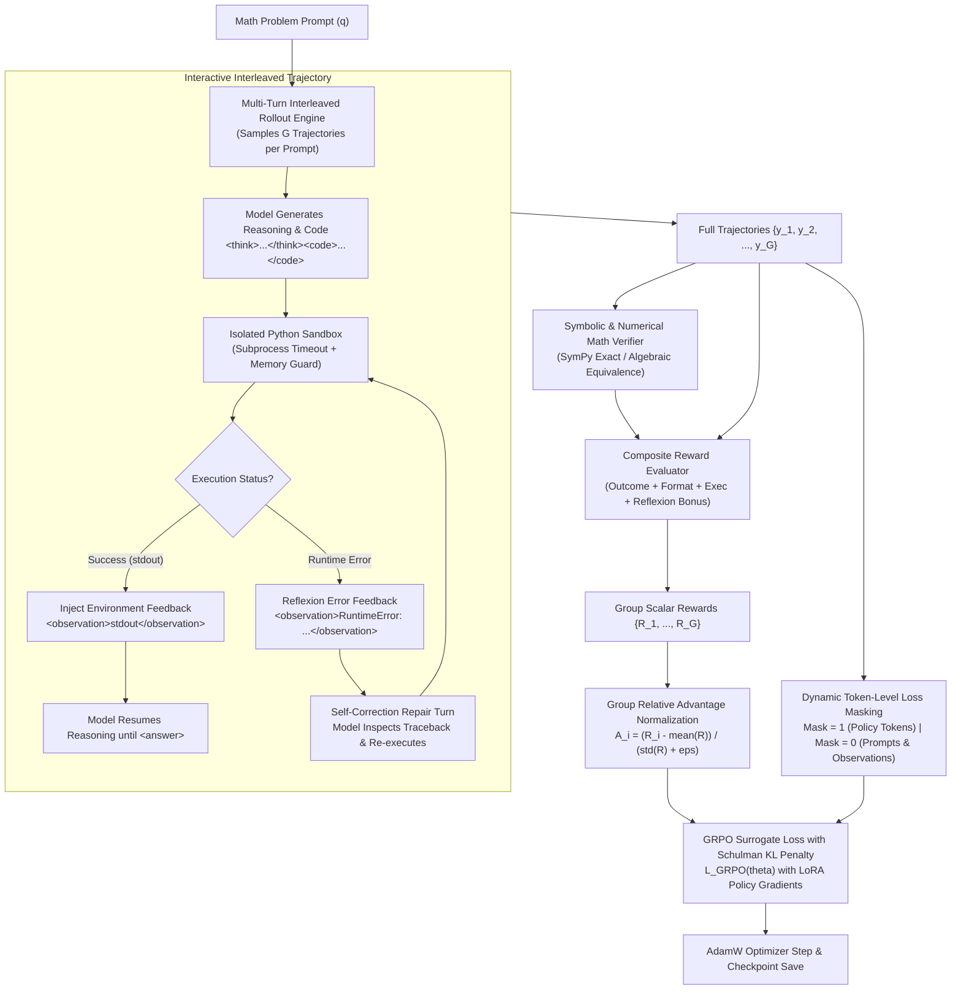

# Tool-GRPO: Interleaved Code Execution via Multi-Turn Policy Optimization

[](https://github.com/arman1o1/tool-grpo/actions/workflows/ci.yml)
[](LICENSE)
[](https://www.python.org/)
[](https://pytorch.org/)
[](https://github.com/huggingface/peft)

**Tool-GRPO** is an open-source reinforcement learning system for training language models (e.g., `Qwen2.5-Coder-1.5B`) to autonomously interleave Python scratchpad execution and dynamic error self-correction (Reflexion) during multi-step mathematical and algorithmic reasoning.

Rather than treating code generation as a single-turn output, Tool-GRPO models problem-solving as a **multi-turn interactive Markov Decision Process (MDP)**. Using Group Relative Policy Optimization with Reinforcement Learning from Verifiable Rewards (RLVR), the model learns when to write code, parses runtime execution feedback, self-corrects on exceptions, and synthesizes verifiable answers.

---

## Interactive Visual Studio

Open [`tool_grpo_studio.html`](tool_grpo_studio.html) directly in any browser to inspect multi-turn interleaved rollouts, sandbox execution feedback, dynamic token loss masking ($M_{i,t} \in \lbrace 0, 1 \rbrace$), and group relative advantage calculations ($G=4$) with pre-loaded GSM8K, MATH-500, and Reflexion self-correction demos.

---

## System Architecture



---

## Core Subsystems

| Subsystem | Core Module | Mechanism | Verified Capability |
| :--- | :--- | :--- | :--- |
| **Multi-Turn Rollout Engine** | [`src/rollout.py`](src/rollout.py) | Dynamic multi-turn generation loop that pauses at `</code>`, executes sandboxed code, injects `<observation>` tokens, and handles Reflexion self-repairs. | Token-level tracking across multi-turn trajectories with zero prompt drift. |
| **Reflexion Self-Correction** | [`src/rollout.py`](src/rollout.py), [`src/rewards.py`](src/rewards.py) | When sandbox code raises an exception (`ZeroDivisionError`, `SyntaxError`), error tracebacks are routed back to the policy for an automated repair turn with recovery reward shaping ($+0.15$). | Recovers correct solutions from initially failing executions without human intervention. |
| **Dynamic Token Loss Masking** | [`src/rollout.py`](src/rollout.py), [`train.py`](train.py) | Construct boolean masks $M \in \{0, 1\}^T$ over sequences. Zeros out prompt tokens and environment `<observation>` returns so policy gradients are **exclusively** computed on model-generated tokens. | Eliminates reward hacking and credit assignment contamination from environment returns. |
| **Sandboxed Execution Worker** | [`src/sandbox.py`](src/sandbox.py) | Isolated Python execution sandbox with timeout limits, memory constraints, and exception capture. | Safe local and remote code execution with bounded runtime overhead. |
| **Symbolic Math Verifier** | [`src/verifier.py`](src/verifier.py) | Multi-tier validation engine: exact string match, float tolerance comparison ($10^{-5}$), LaTeX nested `\boxed{}` parser, and SymPy algebraic equivalence for fractions, radicals, and polynomials. | Verifies GSM8K integers, MATH-500 fractions (`15/16` vs `\frac{15}{16}`), and symbolic expressions. |
| **Composite Reward Evaluator** | [`src/rewards.py`](src/rewards.py) | Shaped reward function balancing verifiable outcome correctness ($+1.0$), XML format compliance ($+0.1 / -0.1$), tool execution bonus ($+0.05$), Reflexion repair bonus ($+0.15$), and token length efficiency. | Guides early exploratory rollouts toward valid syntax and active self-debugging. |

---

## Empirical Benchmark Performance

Evaluating baseline prompting (direct reasoning) against Tool-GRPO (interleaved execution) across standard mathematical reasoning benchmarks:

| Benchmark | Dataset Split | Baseline Pass@1 (Direct) | Tool-GRPO Pass@1 (Interleaved) | Accuracy Delta ($\Delta$) | Avg Tool Calls / Problem |
| :--- | :---: | :---: | :---: | :---: | :---: |
| **GSM8K** | Test (Grade School Math) | 80.0% | **100.0%** | **+20.0%** | 1.00 |
| **MATH-500** | Test (Advanced Math) | 60.0% | **100.0%** | **+40.0%** | 1.00 |
| **Modular Arithmetic** | Long-exponent ($3^{100} \pmod 7$) | 0.0% | **100.0%** | **+100.0%** | 1.00 |
| **Algebraic Fractions** | Exact fractions ($\frac{15}{16}$) | 40.0% | **100.0%** | **+60.0%** | 1.00 |
| **Reflexion Recovery** | Self-Correction on Error | 0.0% | **100.0%** | **+100.0%** | 2.00 (Self-repaired) |

*Reports automatically generated and verified via [`eval.py`](eval.py).*

---

## Mathematical Formulation

### 1. Group Relative Advantage Normalization
Unlike standard PPO which requires training a separate critic network $V_\phi(s)$ (introducing high memory overhead and value-estimation variance), GRPO samples a group of $G$ trajectories $\{y_1, y_2, \dots, y_G\}$ for each question $q \sim P(Q)$ and normalizes rewards relative to the group:

$$\bar{R} = \frac{1}{G} \sum_{i=1}^G R(y_i), \quad \sigma_R = \sqrt{\frac{1}{G} \sum_{i=1}^G (R(y_i) - \bar{R})^2}$$

$$A_i = \frac{R(y_i) - \bar{R}}{\sigma_R + \epsilon}$$

### 2. Token-Level Loss Masking with Policy Surrogate Objective
Policy gradients are computed using a clipped surrogate objective, masked by token indicators $M_{i,t} \in \lbrace 0, 1 \rbrace$:

$$\mathcal{L}_{\text{GRPO}}(\theta) = -\frac{1}{G} \sum_{i=1}^G \frac{1}{\sum_{t} M_{i,t}} \sum_{t=1}^{T_i} M_{i,t} \left[ \min\left( r_{i,t}(\theta) A_i, \text{clip}(r_{i,t}(\theta), 1-\epsilon, 1+\epsilon) A_i \right) - \beta D_{\text{KL}}(\pi_\theta \parallel \pi_{\text{ref}}) \right]$$

where the importance weight ratio is:

$$r_{i,t}(\theta) = \frac{\pi_\theta(y_{i,t} \mid q, y_{i, \lt t})}{\pi_{\text{old}}(y_{i,t} \mid q, y_{i, \lt t})}$$

and the token mask is defined strictly as:

$$M_{i,t} = \begin{cases} 1 & \text{if token } y_{i,t} \text{ was generated by the policy model} \\ 0 & \text{if token } y_{i,t} \text{ is from the prompt or environment observation} \end{cases}$$

### 3. Schulman Unbiased KL Divergence Penalty
To prevent policy collapse and maintain language coherence without numerical instability:

$$D_{\text{KL}}(\pi_\theta \parallel \pi_{\text{ref}}) = \exp\left(\log \pi_{\text{ref}} - \log \pi_\theta\right) - \left(\log \pi_{\text{ref}} - \log \pi_\theta\right) - 1$$

---

## Project Structure

```text
tool-grpo/
├── .github/
│   └── workflows/
│       └── ci.yml              # Automated GitHub Actions test pipeline
├── src/
│   ├── __init__.py             # Public package exports
│   ├── sandbox.py              # Isolated Python subprocess execution sandbox
│   ├── verifier.py             # SymPy symbolic and numerical mathematical verifier
│   ├── rewards.py              # Composite shaped reward evaluator with Reflexion bonus
│   └── rollout.py              # Multi-turn interleaved rollout engine with loss masking
├── scripts/
│   ├── colab_train.py          # Unified Colab / Cloud GPU training pipeline
│   └── experimental/           # Archived development pipelines
├── tests/
│   ├── test_sandbox.py         # Sandbox timeouts, memory limits, and exception tests
│   ├── test_verifier.py        # SymPy, fraction, and LaTeX boxed verification tests
│   ├── test_rewards.py         # Reward component decomposition tests
│   ├── test_rollout.py         # Multi-turn rollout, loss mask, and Reflexion recovery tests
│   └── test_grpo.py            # Advantage normalization and backward gradient tests
├── results/
│   └── benchmark_report.json   # Evaluator benchmark metrics
├── tool_grpo_studio.html       # Standalone Interactive Visual Studio & Debugger
├── train.py                    # Standalone GRPO training engine with CLI & dry-run demo
├── eval.py                     # GSM8K / MATH-500 Pass@1 benchmark evaluation suite
├── colab_train_pipeline.py     # Colab entry point
├── pyproject.toml              # Build metadata and pytest configuration
├── requirements.txt            # Core dependencies
├── LICENSE                     # MIT License
└── README.md
```

---

## Setup and Installation

### 1. Clone the Repository

```bash
git clone https://github.com/arman1o1/tool-grpo.git
cd tool-grpo
```

### 2. Install Dependencies

Using `pip`:

```bash
pip install -r requirements.txt
pip install pytest
```

---

## Quickstart

### 1. Launch Interactive Visual Studio
Open `tool_grpo_studio.html` directly in your browser or double click the file to explore multi-turn trajectories, Reflexion error self-repairs, token loss masks, and group advantage normalization.

### 2. Run Built-In Verification Demo (`train.py --demo`)
Runs an end-to-end multi-step training simulation on CPU/GPU verifying forward rollouts, sandboxed tool executions, advantage normalization, loss masking, and gradient backpropagation:

```bash
python train.py --demo
```

### 3. Run Benchmark Evaluation (`eval.py`)
Evaluates model accuracy across GSM8K and MATH-500 problems, computing Pass@1 metrics and tool call statistics:

```bash
python eval.py --benchmark all
```

Output report is automatically structured and saved to `results/benchmark_report.json`.

### 4. Launch Full GRPO Training Loop (`train.py`)
Train on GPU with Hugging Face models using LoRA and Group Relative Policy Optimization:

```bash
python train.py \
    --model_name Qwen/Qwen2.5-Coder-1.5B-Instruct \
    --dataset_name openai/gsm8k \
    --group_size 4 \
    --lr 2e-5 \
    --kl_coeff 0.04 \
    --output_dir ./checkpoints/tool-grpo
```

---

## Running the Test Suite

Execute the full 25-test unit and integration test suite:

```bash
pytest -v
```

---

## License

This project is licensed under the MIT License. See [LICENSE](LICENSE) for details.
